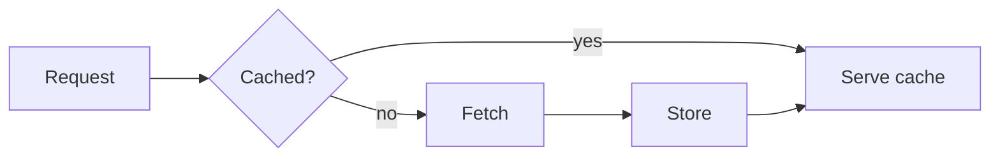

# Visuals in the reply

MCode's conversation renders several kinds of blocks as pictures. Pick the
simplest one that shows the idea, and keep the prose around it short.

## Mermaid, for structure

Flowcharts, sequence diagrams, state machines, class and entity diagrams, Gantt
charts, timelines, mind maps and pie charts:

````

````

- Keep to about 15 nodes; split bigger pictures into two diagrams.
- Quote labels that contain punctuation: `A["Parse (JSON)"]`.
- The reader can zoom, copy or download the rendered diagram, so do not also
  paste its code as text.

## SVG, for drawings and precise charts

A ```svg block (or an `<svg>` element) is drawn as an image. Use it for
illustrations, annotated layouts and charts that need exact positions.

- Always set `viewBox` and leave `width`/`height` off so it scales.
- Use `currentColor` for lines and text so it reads in light and dark themes;
  one accent colour at most.
- No scripts, external images or fonts - they are stripped.

## Math

Inline `$E = mc^2$` and display blocks `$$ ... $$` (or ```math) are typeset.

## Music

A ```abc block renders sheet music in ABC notation, with playback.

## Tables and files

- Small comparisons are clearer as a Markdown table than a chart.
- Charts from real data belong in files: make them with a script (matplotlib),
  save PNG or SVG in the project and call `present_files`, or reference the file
  path in the reply so it shows as an image card.

## Check

Read back the block you wrote for syntax slips (unclosed brackets, a missing
`end`); a block that fails to render shows an error instead of a picture.
